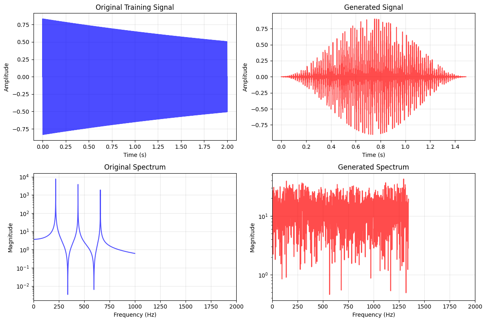

# Spectro 2 — Audio Synthesis Workbench

Train spectral models from your recordings, explore their structure, and generate
new audio from a Linux desktop app or the command line. Spectro includes the SSGS
Python library and a compiled DSP backend.

## Install on Debian / Ubuntu

Build an installable package from this checkout:

```bash
make deb
sudo apt install ./dist/spectro_2.0.0-1_amd64.deb
```

The build requires Python 3.9+, a C compiler, and `dpkg-dev`; it downloads no
dependencies and needs no root access. The filename reflects the build machine's
architecture. APT installs the runtime dependencies from your distribution.
See [installation and package validation](docs/INSTALL.md) for compatibility,
other architectures, removal, and source installation.

Launch **Spectro** from your application menu, or run:

```bash
spectro gui
```

The workbench provides audio file and folder selection, background training with
progress and cancellation between stages, model loading and saving, configurable
generation, waveform and spectrogram previews, and WAV export. **Try demo** creates
a synthetic source, trains a small model, and generates audio without needing a
recording. Generated audio can be opened in your desktop's audio player.

## Command-line workflows

```bash
# Complete demonstration using a synthetic source.
spectro demo --output-dir ./spectro-demo

# Learn from a directory of recordings, including subfolders.
spectro train ./recordings --recursive --states 16 --iterations 10 \
  --seed 42 --output ./models/voice.npz

# Inspect the model, then generate a reproducible 24-bit WAV.
spectro inspect ./models/voice.npz --json
spectro generate ./models/voice.npz --duration 5 --method stochastic \
  --seed 42 --sample-rate 44100 --output ./renders/voice.wav

# Update a model with new recordings while keeping the original model.
spectro adapt ./models/voice.npz ./new-recordings --recursive \
  --output ./models/voice-adapted.safetensors

# Check installed libraries, audio formats, and the selected numeric backend.
spectro doctor
```

Use `.safetensors` instead of `.npz` to save a checkpoint. Supported source formats
depend on the installed libsndfile; WAV, FLAC, OGG (including Opus), and AIFF are
commonly available, and `spectro doctor` reports the formats on your machine.
Existing output files are protected unless you pass `--force`. Model and audio
writes publish atomically (a hard link when the filesystem allows it, an exclusive
create plus `os.replace` otherwise), so an interrupted save never truncates the
previous file.

Renders are bounded before any buffer is allocated: at most 768,000 Hz, at most
3,600 s, and at most 268,435,456 samples (1 GiB of float32) per render. Requests
beyond a limit fail immediately with a one-line error instead of attempting a
multi-gigabyte allocation.
Cancellation takes effect between computation stages; a running analysis or
synthesis stage finishes before cancellation is handled.

For development:

```bash
python3 -m venv .venv
.venv/bin/python -m pip install -e '.[dev]'
make
.venv/bin/python -m ssgs --help
make test PYTHON=.venv/bin/python
```

The desktop requires Tk (`python3-tk` on Debian / Ubuntu). The Python package works
without the optional native library and uses the NumPy/SciPy backend in that case.

## SSGS — Spectral-State Guided Synthesis
### © 2025 Damien Davison & Michael Maillet & Sacha Davison 
### Recursive AI Devs  
Licensed under the Apache License 2.0
psychcoherence@gmail.com OR therealmichaelmaillet@gmail.com

SSGS (Spectral-State Guided Synthesis) is a hybrid generative audio model that
combines **linear predictive coding (LPC)**, **hidden Markov models (HMMs)**,
**spectral clustering**, **graph constraints**, and a **physically-inspired
Karplus–Strong excitation engine** into a single synthesis framework.

Unlike classical systems that commit to a single paradigm (neural, statistical,
or physical), SSGS deliberately **smashes algorithms together** and extracts the
useful computational primitives from each.  
The result is a model that:

- learns spectral structure from real signals,  
- organizes that structure into Markov states,  
- decodes a smooth state trajectory or samples a Markov path over time,
- generates excitation signals using string-model dynamics, and  
- reconstructs audio by filtering excitation through LPC envelopes.

SSGS is not meant to imitate any existing model family.  
It is a new hybrid class: detailed like DSP, global like HMMs, and expressive like
physical models.

---

## Key Idea: “Algorithm Deconstruction”
SSGS is built using the same philosophy behind the Symbo project:

> **Break apart many algorithms, strip them to their mathematical essence,
> recombine only the primitives that are actually useful.**

Instead of inheriting algorithms whole (e.g., a standard HMM, standard LPC vocoder,
standard Karplus–Strong), SSGS takes:

- LPC → spectral envelope representation  
- HMM → temporal clustering + statistical state transitions  
- EM → unsupervised parameter refinement  
- Dynamic programming → smoothness-constrained state sequence
- Karplus–Strong → natural resonance and excitation noise  
- Heuristics → spectral smoothness constraints  
- Graph theory → prune invalid or degenerate state structures  

SSGS then recomposes these pieces into a **single generative pipeline that didn’t
exist before**.

This approach is extremely flexible:
swap the envelope model, swap the excitation, modify the search heuristic — the
system keeps working.

---

## Pipeline Overview

### **1. LPC Analysis**
The training signal is segmented and analyzed with LPC to extract:

- LPC coefficients  
- excitation residual  
- power envelope

These become the feature vectors for clustering.

---

### **2. Spectral Clustering via HMM Initialization**
Frames are embedded into a feature space (typically derived from LPC spectra).
States are initialized using **k-means**, then upgraded into a full **HMM** with:

- initial state distribution  
- transition matrix  
- mean vectors and covariance matrices for each state

---

### **3. Expectation-Maximization (EM) Refinement**
A custom EM implementation updates:

- state responsibilities (γ)  
- pairwise transitions (ξ)  
- transition probabilities  
- Gaussian parameters (means, covariances)

Result: the HMM becomes a structured map of repeating spectral “modes.”

---

### **4. Graph Constraint Pruning**
To prevent degenerate solutions, SSGS analyzes the transition graph:

- identifies strongly connected components (SCCs)  
- removes invalid or isolated states  
- ensures state sequences remain musically plausible

---

### **5. State Decoding and Sampling**

Spectro supports a global dynamic-programming decoder with spectral smoothness
constraints and a stochastic Markov sampler with adjustable temperature. Viterbi
decoding is a global optimization, and the historical `_a_star_search` entry point
now delegates to that decoder. Stochastic sampling offers varied state paths from
the learned transition probabilities.

---

### **6. Physically Inspired Excitation**
The decoded state sequence modulates a **Karplus–Strong** string model,
producing a dynamic excitation that is:

- rich in overtones  
- noisy where appropriate  
- resonant and evolving

---

### **7. LPC Synthesis**
Finally, excitation is passed through the LPC filters of each decoded state:

- reconstructs spectral envelopes  
- restores formants and resonances  
- yields new but structurally coherent audio

This is how SSGS generates *novel signals* even from short or simple training data.

---

## Model Export, Compression, and Checkpointing

After training you can persist the learned parameters in a compact archive:

```python
ssgs.export_model("models/ssgs_baseline", use_compression=True, pack_covariances=True)
```

- `.npz` output uses ZIP compression by default when `use_compression=True`.
- Covariance matrices are serialized as lower-triangular slices to halve their
   stored size.
- Set `include_training_artifacts=True` if you also need cached LPC and residual
   buffers for later analysis.
- Reload the model with `SpectralStateGuidedSynthesis.load_model(path)`.

For long-running training, SSGS also supports `.safetensors` checkpoints:

```python
ssgs.save_checkpoint("models/checkpoint_epoch_5.safetensors")
ssgs = SpectralStateGuidedSynthesis.load_checkpoint("models/checkpoint_epoch_5.safetensors")
```

Checkpoints can optionally persist adaptive statistics so continuous learning can resume
without reprocessing previous audio.

---

## Generative Capability Levels

SSGS now offers enhanced generative capabilities through configurable state counts:

- **Standard (16 states)**: Original baseline configuration
- **Enhanced (34 states)**: 112% increase - recommended for most applications
- **Maximum (42 states)**: 163% increase - highest generative capacity

```python
# Enhanced generative capabilities (default)
ssgs = SpectralStateGuidedSynthesis(n_states=34)

# Maximum generative capabilities
ssgs = SpectralStateGuidedSynthesis(n_states=42)

# Original baseline
ssgs = SpectralStateGuidedSynthesis(n_states=16)
```

More states = more spectral patterns the model can learn and generate = richer, more diverse output.

---

## Example Output

SSGS produces time-domain and spectral visualizations like this:



For a deeper comparison diagnostic, see `data/ssgs_analysis.png`.

The generated signal is not a copy —  
it is a **new trajectory** through learned spectral states.

---

## Quick Start

Install dependencies:

```bash
pip install -r requirements.txt
```

Run the demo training + generation script:

```bash
python tests/test_ssgs.py
```

Run the enhanced capabilities demo (defaults to 34 states):

```bash
python examples/demo_enhanced_capabilities.py
```

Train on folders of audio with checkpointing:

```bash
python examples/train_on_folder.py --folders training_001 training_002
```

## Robustness, Input Handling & Reproducibility

SSGS validates its configuration, features, and model parameters before numerical
work begins. Audio inputs must be finite mono samples or samples-by-channels arrays;
integer PCM is centered/scaled to floating point, stereo is downmixed, and file
inputs are resampled to the requested analysis rate. Framing pads the final partial
hop so the tail of a recording is not silently dropped. When training on multiple
recordings, each recording (and each augmentation) is marked as a separate HMM
sequence, so EM does not learn a fabricated transition across file boundaries.

Use a seed for repeatable initialization and seeded stochastic generation:

```python
from ssgs import SpectralStateGuidedSynthesis

model = SpectralStateGuidedSynthesis(n_states=16, random_state=42)
model.train(["speech_a.wav", "speech_b.wav"], sample_rate=16000, n_em_iterations=10)
audio = model.generate(
    duration_seconds=3.0,
    sample_rate=22050,
    method="stochastic",
    seed=123,
)
```

The model uses regularized positive-definite state covariances, smoothed transition
probabilities, continuous LPC filter state during synthesis, and output resampling
with exact requested sample counts. NPZ exports and safetensors checkpoints are
written atomically; loading validates tensor shapes, values, and aligned optional
training artifacts. Set `include_training_artifacts=True` when exporting if you
need cached frames, residuals, and original sequence boundaries for analysis or
retraining. The optional native backend remains interchangeable with the NumPy
reference path.

Run the complete regression suite with:

```bash
python -m pytest -q
```

## Adaptive Learning

SSGS can adapt to new audio using persistent statistics:

```python
ssgs.adapt_to_audio(new_audio, sample_rate=16000, adaptation_rate=0.5, memory_blend=0.3)
```

Adaptation can be exported through `.npz` or `.safetensors` artifacts and reloaded later.

## Feature Indexing & Retrieval

Use built-in nearest-neighbor search over frame features for exploration and analysis:

```python
index = ssgs.build_feature_index(feature_space="lpc", normalize=True)
result = ssgs.query_similar_frames(frame_idx=42, k=8, feature_space="lpc")
vector_result = ssgs.search_by_feature_vector(
    vector=index.tree.data[0],
    k=5,
    feature_space="lpc",
)
```

The returned `FrameQueryResult` includes indices, optional distances, and frame metadata.

## Performance: Native Compiled Backend

The numeric hot loops are also implemented as a small, dependency-light C
library (`src/ssgs/ssgs_native.c`) and exposed through `ssgs.native`. `ssgs.model`
automatically uses them when `libssgs_native.so` is loadable, and falls back to
the existing SciPy/NumPy paths otherwise — so the package still works on a
machine with no compiler installed.

Kernels covered: LPC (Levinson–Durbin), Gaussian emission (hand Cholesky +
forward solve), EM forward–backward, and the smoothness-first Viterbi decode.
The decode is the dominant synthesis cost (a pure-Python triple loop in the
SciPy build). Measured with `python -m ssgs.native` (Python 3.11.2, NumPy 2.4.6,
SciPy 1.17.1, `-O3`, this workstation):

| kernel                | `ssgs.core` reference | C library   | speedup |
|-----------------------|-----------------------|-------------|---------|
| LPC (340 frames)      | 0.0128 s              | 0.0032 s    | 4.0×    |
| Gaussian emission     | 0.0028 s              | 0.0014 s    | 2.0×    |
| decode (2000 frames)  | 0.5028 s              | 0.0030 s    | 168×    |

The reference column times the pure-NumPy kernels in `ssgs.core`, **not**
`SpectralStateGuidedSynthesis` methods: those already dispatch to the compiled
library when it is loadable, which made earlier versions of this table compare
the native kernel with itself. The C kernels are numerically identical to
`ssgs.model` (enforced by `tests/test_regression_guard.py` and recorded in
`TODO.md`). Build the library with:

```bash
make            # produces src/ssgs/libssgs_native.so (requires gcc)
```

A pure-NumPy reference implementation lives in `ssgs.core` (`src/ssgs/core.py`) and is used by the
regression guard to prove equivalence even when the compiled library is absent.

---

### Peak memory

Feature extraction is streamed instead of materialising whole matrices. For a
72,510-frame training set (297 MB of frames) the folder-training script peaks at
**1018 MB RSS** instead of 2421 MB, `_compute_frame_metadata` peaks at 15.8 MB
instead of 307.2 MB, and `_process_frame_batch` peaks at 80.5 MB instead of
218.8 MB. `tests/test_resource_bounds.py` keeps those bounds honest by comparing
transient allocation against the size of the data being processed.

## Testing

```bash
make test PYTHON=.venv/bin/python     # builds the C kernels, then runs pytest
```

The suite contains 296 pytest cases (290 execute here; the remaining 6 need a
display for the Tk workbench). CI runs it on Python 3.9, 3.10, 3.11 and 3.12
with the native kernel built, and
`tests/test_python_support.py` parses every shipped module with a 3.9 grammar so
a newer-only construct cannot land unnoticed.

Run individual checks as standalone scripts:

```bash
python tests/test_ssgs.py
python tests/test_checkpoints.py
python tests/test_adaptive_persistence.py
python tests/test_data_indexing.py
python tests/test_gain_control.py
python tests/test_generative_capabilities.py
python tests/test_signal_generators.py
```

Numeric-equivalence and performance gates:

```bash
python -m ssgs.core               # pure-NumPy core self-test (equivalence oracle)
python -m ssgs.native             # compiled-kernel verify + benchmark
python tests/test_regression_guard.py   # native load + core/pipeline equivalence
```


### Requirements

```
numpy>=1.21.0
scipy>=1.7.0
matplotlib>=3.4.0
soundfile>=0.10.0
PyWavelets>=1.1.0
safetensors>=0.4.0
```

Optional: `gcc` and `make` to build the native backend (`libssgs_native.so`).
If unavailable, SSGS falls back to the SciPy/NumPy paths automatically.

### Project Structure

```
spectro/
├── src/ssgs/
│   ├── __init__.py             # Package exports (SpectralStateGuidedSynthesis)
│   ├── model.py                # Full model implementation
│   ├── core.py                 # Pure-NumPy reference kernels (equivalence oracle)
│   ├── native.py               # ctypes wrapper + benchmark for the C kernels
│   └── ssgs_native.c           # Compiled C kernels (Levinson-Durbin, emission, EM, decode)
├── tests/                      # Test suite (pytest-compatible)
├── examples/
│   ├── train_on_folder.py      # Folder-based training with checkpointing
│   ├── demo_enhanced_capabilities.py  # State-count showcase
│   ├── example_checkpoints.py  # Checkpoint usage example
│   └── example_fidelity.py     # Fidelity-focused generation example
├── docs/                       # Design and usage documentation
├── data/                       # Example signals and visualizations
├── training_001/               # Sample training audio
├── training_002/               # Sample training audio
├── Makefile                    # Builds src/ssgs/libssgs_native.so
├── requirements.txt            # Dependencies
└── README.md                   # This document
```


### Authors

Damien Davison & Michael Maillet & Sacha Davison
Recursive AI Devs

We build hybrid-symbolic neural, statistical, and physical AI systems by
algorithm decomposition — extracting the useful primitives and recombining them
into new model classes.

If you use SSGS in research or production, please cite the authors.


### License — Apache 2.0

This project is licensed under the Apache License, Version 2.0.

Copyright 2025
Damien Davison & Michael Maillet
Recursive AI Devs

Licensed under the Apache License, Version 2.0 (the "License");
you may not use this file except in compliance with the License.
You may obtain a copy at:

   http://www.apache.org/licenses/LICENSE-2.0

## NOTICE

This product includes original work by:  
**Damien Davison & Michael Maillet & Sacha Davison (Recursive AI Devs)**  
Additional details can be found in the project's LICENSE and source headers.
